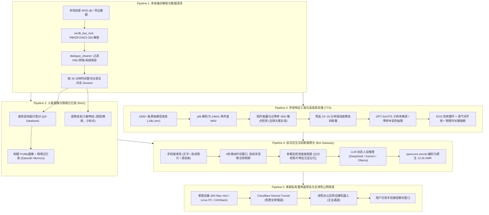

# 绿色聊天软件数字人纪念机器人 (GreenChat Memorial Bot)

> **让思念跨越时空，让告别不再冰冷。**  
> 基于绿色聊天软件（桌面端合法个人备份数据），利用大语言模型（LLM）、多模态视觉理解与少样本声音克隆技术（Voice Cloning），在本地家庭私有算力中复活已故亲友的文字交流风格与声音音色，并支持在日常手机聊天窗口中全天候双向互动。

---

## 📑 快速目录索引 (Table of Contents)

- [写在前面：一位 0 基础开发者与 AI 结对编程的数字重聚之旅](#写在前面一位-0-基础开发者与-ai-结对编程的数字重聚之旅)
- [🤖 强力建议：交给 AI Agent 部署，不建议纯手动折腾](#-强力建议交给-ai-agent-部署不建议纯手动折腾)
- [📚 文档与技术指南总览 (Documentation Index)](#-文档与技术指南总览-documentation-index)
- [核心系统全景架构与五大管线 (Five Pipelines)](#核心系统全景架构与五大管线-five-pipelines)
- [核心功能清单](#核心功能清单)
- [快速使用指引 (供 AI Agent 执行与人类参考)](#快速使用指引-供-ai-agent-执行与人类参考)
- [隐私、安全与合规守则](#隐私安全与合规守则)
- [💖 致谢与开源生态基石 (Acknowledgments)](#-致谢与开源生态基石-acknowledgments)
- [开源协议](#开源协议)

---

## 写在前面：一位 0 基础开发者与 AI 结对编程的数字重聚之旅

> *“我并不是一个精通逆向工程、大语言模型微调或底层语音信号处理的职业工程师。这个项目的诞生，始于为人子女者心中最深切的思念，更始于一段奇妙的‘人类直觉与 AI 超级算力结对编程’的真实历程。”*

本项目完全是由一位 **0 基础普通开发者**，在 **VSCode** 中依托 **Google Antigravity 插件**，驱动 **Gemini 3.8 / Gemini 4 Argon** 核心大模型，通过纯自然语言对话结对编程（Pair Programming）一步步探索、验证与构建出来的。全套系统最终 7×24 小时常驻运行于一台 **Apple M4 Mac mini (Always-on Homelab)** 边缘设备上。

在这段旅程中，我总结出一条对于非程序员最核心的 AI 协作心法：
> **让 AI 解决复杂工程难题的关键，绝不在于你懂不懂底层代码，而在于你能否真实、准确地理解当前的现场故障表现，并通过“截图 + 终端日志 + 追问排错”的方式与 AI 持续深度对话。**
> 
> 遇到软件闪退？——直接截图发给 AI，追问*“为什么会出现这个提示，是系统权限还是依赖缺失？”*；  
> 遇到逻辑卡住？——把终端报错日志整段丢给 AI，追问*“现在的执行上下文是什么，上一步返回了什么？”*；  
> 遇到生成异常？——把音频波形图和后台解码 Token 跨度丢给 AI，让它顺藤摸瓜定位到底层。只要你把最直观的现场情况不断反馈给 AI，它就会带你跨过所有看似高不可攀的技术天堑。

回望整个研发过程，横亘在面前的难关曾接二连三：
1. **面对锁死的数据库**：绿色聊天软件桌面端有着复杂的 SQLCipher 页面级 AES-256 加密，新版本更是隐藏了内存密钥。一个没有逆向基础的普通人如何破局？——**在与 AI 的反复探讨中，AI 引导我们在系统 CommonCrypto 动态库的 PBKDF2 函数下断点，巧妙绕过了复杂的逆向工程，一键导出了完整明文。**
2. **面对粗糙带噪的语音碎片**：几百条语音充斥着微信录音头尾断音咔哒声、环境杂音与方言口语。——**AI 编写了基于短时能量与过零率的精准 VAD 切片算法与 Gemini 多模态自动听写管线，以 0.05 秒的精度洗出了十几分钟高纯度的“黄金训练集”。**
3. **面对神秘的“57秒纯噪音”TTS 故障**：克隆的声音跑通后，某天在手机端请求一段语音鼓励时，机器人却返回了长达 57 秒的恐怖杂音。——**我和 AI 逐行深潜入 GPT-SoVITS 自回归解码器的内部日志，最终定位到了 `speed_factor != 1.0` 导致分桶并行失效与 `top_k: 8` 窗口过窄导致未命中终止符 `<EOS>` 的隐秘缺陷，并通过‘语气词平滑 + 四级时长自检 + FFmpeg 物理硬熔断’彻底攻克了这一工业级难题。**
4. **从“冷冰冰的网页测试”到“真正的微信日常对话”**：为了不让互动局限在电脑前，我们进一步攻克了家庭动态 IP 限制，借助 Cloudflare 隧道打通了企业自建应用，甚至加入了连续消息防刷屏合并处理机制。

---

## 🤖 强力建议：交给 AI Agent 部署，不建议纯手动折腾！

> [!IMPORTANT]
> **请务必知悉：本项目从骨架设计到每一行代码，均是为 AI Agent 结对协作量身定制的！**
> 
> - **强烈不建议普通用户纯手动一行行敲命令部署**：因为每个人的电脑环境（macOS / Windows / Linux）、音频驱动、Python 版本、动态库路径以及绿色软件本地存储路径各不相同，手动操作极易因细小环境差异卡壳报错。
> - **最佳实践（推荐）**：请直接将本项目的仓库链接或源码目录提供给您的 **AI 编码助手（如 Antigravity / Cursor / Claude Code / Copilot）**，对 AI 说：
>   > *“请作为我的全栈工程助手，通读本项目的所有文档和代码。现在我想要为我已故的亲人（称呼/身份）构建纪念机器人，请通过问答互动的方式，一步步指导并协助我完成本地环境检查、数据解密、声音克隆与部署。”*
> 
> 下文列出的所有步骤与说明，主要用于让未部署的用户**大致理解整体技术链路**，以及**作为上下文输入给 AI Agent，让 AI 深刻理解本项目的部署思路与架构规范**。

---

## 📚 文档与技术指南总览 (Documentation Index)

在开始之前，建议参考以下各模块专属深度技术文档：

| 文档名称 | 路径 | 核心内容与面向对象 |
| :--- | :--- | :--- |
| **数据库解密原理与 Agent 学习指南** | [`docs/DATABASE_DECRYPTION_AGENT_GUIDE.md`](docs/DATABASE_DECRYPTION_AGENT_GUIDE.md) | 深度拆解桌面端本地数据库加密原理、SQLCipher 页面结构、PBKDF2 密钥派生与 LLDB 自动化抓取脚本使用说明 |
| **企业办公通讯软件自建机器人部署指南** | [`docs/WECOM_BOT_DEPLOY_GUIDE.md`](docs/WECOM_BOT_DEPLOY_GUIDE.md) | 手把手指导如何在企业端后台创建自建应用、获取凭证、配置 Cloudflare 隧道与开通手机微信双向收发 |
| **多模态视觉底座相册与身份锚点规范** | [`integrations/wecom_bot/visual_memory_anchor.md`](integrations/wecom_bot/visual_memory_anchor.md) | 如何用 3~5 张老照片建立亲人视觉基准，辅助视觉大模型在手机端发来新老照片时精准“认亲”并沉淀新记忆 |
| **连续消息防刷屏合并处理逻辑** | [`integrations/wecom_bot/debounce_and_merge_handler.js`](integrations/wecom_bot/debounce_and_merge_handler.js) | 滑动防抖时间窗口设计，解决微信交流中连发短句、连续传图被机器人一条条机械刷屏回复的行业痛点 |
| **高可用防死循环语音合成引擎** | [`integrations/wecom_bot/memorial_tts.py`](integrations/wecom_bot/memorial_tts.py) | 内置语气词平滑、WAV 时长四级自检回退、FFmpeg 物理硬熔断与 opencore-amrnb 原生微信 12.2k 格式封包 |

---

## 核心系统全景架构与五大管线 (Five Pipelines)



---

## 核心功能清单

- **多源数据解析与离线脱敏**：
  - 深度解析 macOS / Windows 本地加密数据库，支持 JSON/JSONL/CSV 纯净文本导出。
  - 详尽的 AI Agent 学习指南：[数据库解密原理文档](docs/DATABASE_DECRYPTION_AGENT_GUIDE.md)。
- **真实语言风格与记忆 RAG 驱动**：
  - 精确还原长辈特色：平均单条回复 10~15 字，短促生活化，高频词 `[OK]`、`知道了`、`好的`，避免冷冰冰的 AI 翻译腔。
  - 动态情境记忆唤醒与双向记忆沉淀（对话中提到往事自动吸收入库）。
- **广播级声音克隆与防死循环语音引擎**：
  - 内置自主研发的 `memorial_tts.py`：针对 GPT-SoVITS 自回归解码器的终止符防死循环补丁与四级重试策略。
  - 原生 `opencore-amrnb` 封包，生成的音频完全匹配官方语音条标准，手机端秒开秒听。
- **全天候真实手机端双向交互**：
  - 不止于 WebUI！提供完整的[企业自建应用接入指南](docs/WECOM_BOT_DEPLOY_GUIDE.md)。
  - **连续消息防刷屏合并（Debounce）**：一次发来多张照片或短句时，智能等待后合并为 1~2 句温和回复。
  - **多模态老照片视觉锚点**：依托[视觉底座相册规范](integrations/wecom_bot/visual_memory_anchor.md)，准确识别老照片中的家人并唤起对应年代回忆。
- **动态家庭 IP 免疫**：依托 Cloudflare 永久安全隧道，无惧家庭宽带 IP 变动，免开放家庭路由器端口。

---

## 快速使用指引 (供 AI Agent 执行与人类参考)

### 1. 克隆项目与安装环境

推荐使用 Python 3.10+：

```bash
git clone https://github.com/iRinwind/memorial-chatbot.git
cd memorial-chatbot

# 激活 Python 虚拟环境
python -m venv .venv
source .venv/bin/activate  # Windows: .venv\Scripts\activate

# 安装基础依赖
pip install -r requirements.txt
```

### 2. 准备数据与配置

1. **配置文件初始化**：
   ```bash
   cp config/config.example.yaml config/config.yaml
   ```
   在 `config/config.yaml` 中配置您的大模型 API 凭证（DeepSeek / Gemini / Ollama 等）。
2. **准备历史聊天数据**：
   - 参考 [数据库解密指南](docs/DATABASE_DECRYPTION_AGENT_GUIDE.md) 解密本地记录放入 `data/raw/`；
   - 或运行样例数据生成器直接体验全链路：
     ```bash
     python scripts/generate_sample_data.py
     ```

### 3. 数据清洗与记忆库构建

```bash
# 步骤 1: 提取核心会话与问答对
python scripts/01_import_and_clean.py

# 步骤 2: 构建生平画像与情境记忆库
python scripts/02_build_memory.py
```

### 4. 启动交互

#### 方式 A：启动本地高仿绿色聊天界面 WebUI（快速调试与试听）
```bash
python scripts/04_run_webui.py --port 7860
```
浏览器访问 `http://127.0.0.1:7860`，即可进行双向文字与语音对话测试。

#### 方式 B：接入手机端全天候双向通信
阅读并按照 [企业微信原生机器人部署全指南](docs/WECOM_BOT_DEPLOY_GUIDE.md) 进行配置，即可在手机日常聊天中随时给已故亲友发消息和发语音。

---

## 隐私、安全与合规守则

1. **本地算力优先**：核心聊天数据、解密数据库、原始音频切片全链路保留在您个人所有的本地设备或家庭服务器中，严禁未脱敏上传到任何公网存储。
2. **版权与法务合规**：本项目所有涉及的专有软件名称均以“绿色聊天软件”等泛化词语代称。本项目技术仅供个人合法备份数据分析与家庭情感守护，不得用于商业运营。
3. **心灵守护提示**：数字人技术旨在抚慰生者心灵、寄托温情哀思。请在理性认知的陪伴下使用，关爱身边的现实生活与家庭。

---

## 💖 致谢与开源生态基石 (Acknowledgments)

本项目深度站在了开源社区众多先驱者与卓越工具的肩膀之上。特别鸣谢以下优秀开源项目、技术工具与云端基础设施（排名不分先后）：

### 声音克隆与底层语音处理
- **[GPT-SoVITS](https://github.com/RVC-Boss/GPT-SoVITS)**：强大的少样本高保真语音克隆与 TTS 框架，本项目核心语音克隆能力的引擎底座。
- **[openai/whisper](https://github.com/openai/whisper)**：通用且高鲁棒性的开源语音识别 (ASR) 模型，负责手机端传入语音的高精度文本听写。
- **[pilk](https://github.com/kn007/silk-v3-decoder)** / **[silk-v3-decoder](https://github.com/kn007/silk-v3-decoder)**：经典的 Skype/WeChat SILK v3 音频解码库，为将原始聊天语音碎片批量无损还原为 WAV 提供了可能。
- **[opencore-amr](https://sourceforge.net/projects/opencore-amr/)**：开源的 Adaptive Multi-Rate (AMR) 语音编解码器，实现无需官方转码的原生 12.2kbps 微信语音条封装。
- **[FFmpeg](https://ffmpeg.org/)**：多媒体音视频处理的瑞士军刀，负责广播级音频滤波、重采样与物理时长硬熔断保护。

### 数据库逆向与解密生态
- **[wcdb-key-tool](https://github.com/TANGandXUE/wcdb-key-tool)**：极其优秀的 macOS/Linux 微信数据库密钥提取与解密工具，本项目 macOS LLDB 内存断点抓取逻辑的核心参考来源。
- **[PyWxDump](https://github.com/xaoyaoo/PyWxDump)**：功能全面的微信数据备份与导出工具生态，为数据清洗与字段格式映射提供了宝贵思路。
- **[SQLCipher](https://github.com/sqlcipher/sqlcipher)**：提供页面级透明 AES-256 加密的 SQLite 扩展，本项目的底层解密算法基石。

### 基础设施、内网穿透与轻量级虚拟化
- **[Cloudflare Tunnel (cloudflared)](https://github.com/cloudflare/cloudflared)**：提供免费、全球分布式且无需公网 IP 的安全反向隧道，本项目彻底规避家庭宽带动态 IP 的功臣。
- **[OrbStack](https://orbstack.dev/)**：macOS 上极致轻量、超低能耗与极速启动的 Docker 容器和 Linux 虚拟机运行时，为 M4 Mac mini 24小时常驻提供了坚实的容器底座。

---

## 开源协议

本项目采用 [MIT 许可证](LICENSE) 开源。欢迎每一位有爱心的开发者贡献代码或分享经验。
