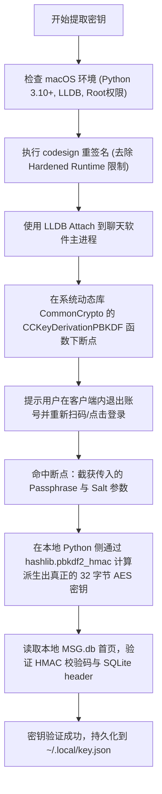

# 绿色聊天软件本地数据库解密原理与 AI Agent 学习指南

> **适用场景**：指导开发者或自主 AI Agent 理解绿色聊天软件在 macOS / Windows 客户端的本地数据库加密原理、安全提取解密密钥并在本地无损导出明文 SQLite 数据库。
> 
> **声明**：本指南仅用于用户个人合法拥有的备份数据恢复、数字遗产保护与私人纪念，严禁用于任何侵犯他人隐私或非法分析用途。

---

## 一、绿色聊天软件本地数据库核心加密原理

绿色聊天软件桌面端（macOS / Windows）为保护本地隐私，对所有聊天记录（`MSG.db`、`contact.db` 等）采用了基于 **SQLCipher** 的透明页面级加密（Page-level Encryption）：

1. **基本规格与数据结构**：
   - **页面大小 (Page Size)**：固定为 `4096` 字节（4KB）。
   - **加密算法**：`AES-256-CBC`（密码块链接模式）。
   - **校验算法**：`HMAC-SHA1`（64 字节）或 `HMAC-SHA256`。
   - **保留区域 (Reserve Size)**：每个 4096 字节页面的末尾固定保留 `80` 字节（由 `16` 字节的 IV 向量 + `64` 字节的 HMAC 校验码组成）。实际加密的数据载荷为前 `4016` 字节。
   - **盐值 (Salt)**：数据库文件开头的第 1 到 16 字节为随机盐值（Salt）。

2. **密钥派生演进（关键对抗点）**：
   - **早期版本 (如 macOS 4.0.x 及更早)**：客户端启动并登录后，生成的 32 字节 Raw Key（含 Salt）以明文形式直接缓存在进程内存中。此时可通过简单的内存正则表达式扫描 `x'<64hex_enc_key><32hex_salt>'` 直接提取。
   - **现代版本 (如 macOS 4.1.x+)**：为防止内存明文读取，客户端不再常驻 Raw Key，而是在用户输入登录或从本地安全存储唤醒时，通过系统级加密库（如 Apple 的 `CommonCrypto` 中的 `CCKeyDerivationPBKDF` 函数）执行 **PBKDF2-HMAC-SHA1** 派生出临时解密密钥。

---

## 二、AI Agent 自动化密钥提取机制 (以 macOS 为例)

对于现代客户端，逆向逆向已剥离符号表的应用二进制十分繁琐且极易失效，因此最优雅稳健的方案是**断点系统自带的公共加密符号**：



### 关键步骤操作指令：
1. **解除 Hardened Runtime 签名防护**：
   macOS 原版应用开启了代码签名保护，禁止调试器（LLDB）注入。需在终端执行一次免证书重签名：
   ```bash
   sudo codesign --force --deep --sign - /Applications/GreenChatApp.app
   ```
2. **启动密钥捕获工具**：
   ```bash
   sudo python3 scripts/wcdb_key_tool_macos.py extract
   ```
3. **在客户端重新登录**：
   在设置中点击“退出当前账号”，重新点击登录。LLDB 捕获到系统派生密码后，将自动计算出十六进制密钥。

---

## 三、离线数据库批量解密与导出

一旦获取到 32 字节的十六进制 Key 与 Salt：

1. **逐页解密算法**：
   - 打开加密的 `MSG.db`；
   - 提取文件前 16 字节作为 Salt，后续每 4096 字节为一个 Page；
   - 每个 Page 的最后 80 字节为 `IV (16B) + HMAC (64B)`；
   - 使用 `AES-256-CBC(key, iv)` 解密前 4016 字节；
   - 解密后的第 1 页开头 16 字节必须匹配标准 SQLite 文件头标识：`SQLite format 3\x00`。
2. **执行解密脚本**：
   ```bash
   sudo python3 scripts/wcdb_key_tool_macos.py decrypt
   ```
   解密后的明文数据库将保存在 `decrypted/` 目录下，可直接使用 Python `sqlite3` 或 Navicat / DB Browser for SQLite 打开读取。

---

## 四、AI Agent 自动化调用流水线映射

解密完成后，AI Agent 可按照以下标准管线依次执行数据提炼：

1. **`modules/parser/wechat_db_parser.py`**：遍历 `MSG.db` 的 `message` 表，根据 `type=1` (文本), `type=34` (语音), `type=3` (图片) 读取完整聊天时间流。
2. **`modules/cleaner/dialogue_cleaner.py`**：自动清洗拍一拍、红包、转账等系统噪音，按 30 分钟无缝时间窗聚合成对话 Session。
3. **`scripts/prepare_voice_dataset.py`**：将 `type=34` 对应的 SILK 音频利用 `pilk` 解码并进行能量 VAD 裁切，形成高保真声音克隆训练集。
