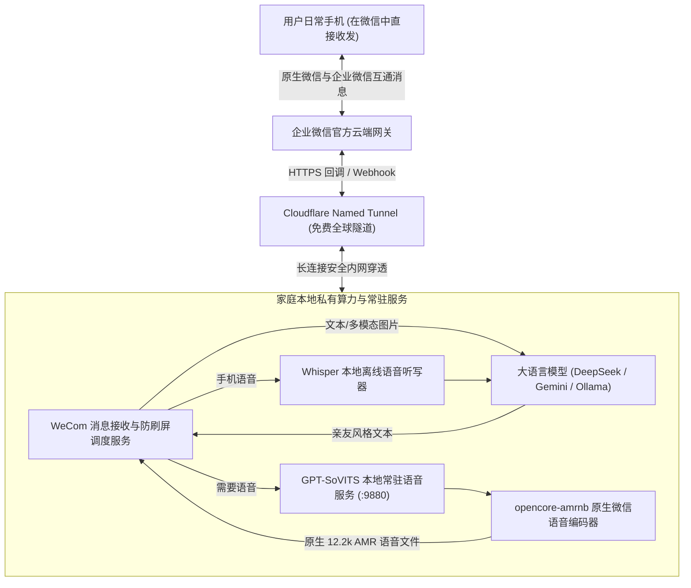

# 绿色办公软件自建应用机器人 (WeCom Agent) 部署与全天候运行指南

> **核心价值**：相较于仅能在电脑浏览器上操作的 WebUI，通过将机器人接入绿色办公通讯软件（企业自建应用），你可以直接在日常手机聊天软件（通过关联的企业微信消息互通窗口）中，随时向已故亲友发送文字、互发语音条、甚至发送家庭老照片并收到秒级回复。

---

## 一、系统整体交互拓扑



---

## 二、第一步：企业微信管理后台创建自建应用

1. **注册企业（个人即可免费注册）**：
   - 访问 [企业微信管理后台 (work.weixin.qq.com)](https://work.weixin.qq.com/)，注册一个个人主体或工作室主体（无需营业执照）。
2. **创建自建应用**：
   - 进入【应用管理】 $\to$ 【自建】 $\to$ 点击【创建应用】；
   - **应用名称**：例如填写 `已故亲友称谓`（如“父亲”或“思念信箱”）；
   - **上传头像**：挑选一张亲人生前温和慈爱的照片作为头像；
   - **可见范围**：选择你自己（或仅允许需要共同缅怀的核心家人）。
3. **记录核心凭证**：
   - **CorpId**（企业ID）：在【我的企业】最下方查看。
   - **AgentId**：在自建应用详情页查看。
   - **Secret**：在自建应用详情页获取（需通过手机企业微信确认）。

---

## 三、第二步：解决家庭宽带动态 IP 问题 (Cloudflare Tunnel)

企业微信要求填写公网接收回调的 URL（接收发给应用的消息）。中国绝大多数家庭宽带没有固定公网 IP，且禁止直接暴露 80/443 端口。

**终极解决之道：Cloudflare Named Tunnel（完全免费、全球 CDN 抵御攻击、免固定公网 IP）**：

1. **安装 cloudflared**：
   - macOS: `brew install cloudflared`
   - Linux: `sudo apt install cloudflared`
2. **在 Cloudflare Zero Trust 仪表盘配置永久隧道**：
   - 登录 [one.dash.cloudflare.com](https://one.dash.cloudflare.com/)；
   - 导航到 `Networks` $\to$ `Tunnels` $\to$ 点击 `Create a tunnel`；
   - 复制生成的 Token，在本地服务器运行常驻服务：
     ```bash
     sudo cloudflared service install <YOUR_TUNNEL_TOKEN>
     ```
   - 在 Public Hostname 中添加一条域名规则：
     - **Subdomain**：例如 `memorialservice`
     - **Domain**：你的托管域名（如 `yourdomain.com`）
     - **Service Type**：`HTTP`
     - **URL**：`localhost:18789`（你的网关监听端口）
3. **完成微信回调验证**：
   - 在企业微信应用设置【接收消息服务器配置】中填写：
     - **URL**：`https://memorialservice.yourdomain.com/webhook`
     - **Token** / **EncodingAESKey**：点击随机生成并填入 `config/config.yaml`。

---

## 四、第三步：启动本地常驻服务群

在家庭服务器上，启动以下 2 个核心服务：

### 1. 启动本地语音合成常驻 WebAPI
```bash
bash scripts/start_tts_api.sh
```
该服务加载已微调好的 GPT-SoVITS 权重并常驻于内存（127.0.0.1:9880），后续每次合成仅需约 1.5 秒。

### 2. 启动消息网关与防死循环语音管线
将 `integrations/wecom_bot/memorial_tts.py` 与 `transcribe_inbound_voice.py` 软链接或配置到网关工作目录。

---

## 五、第四步：防死循环与防刷屏双重保障说明

1. **长辈语音死循环（EOS Runaway）物理熔断**：
   - 详见 `integrations/wecom_bot/memorial_tts.py`。
   - 传统自回归 TTS 模型在面对特定字词组合或标点缺失时，偶发未生成结束符 `<EOS>` 导致生成数十秒纯底噪语音。
   - 本套脚本内置严格的字数时长校验比对及四级回退机制，并在 `ffmpeg` 管线中增加 `-t` 物理时长熔断保护，绝对保证发往手机的每一条语音都是几秒钟干脆利落的自然原声。
2. **连续消息聚合回复（Debounce）**：
   - 详见 `integrations/wecom_bot/debounce_and_merge_handler.js`。
   - 杜绝传统 Bot 机械的一问一答，实现“连续收到多张老照片与多段文字后，沉淀记忆并作温暖的一次回顾”。
